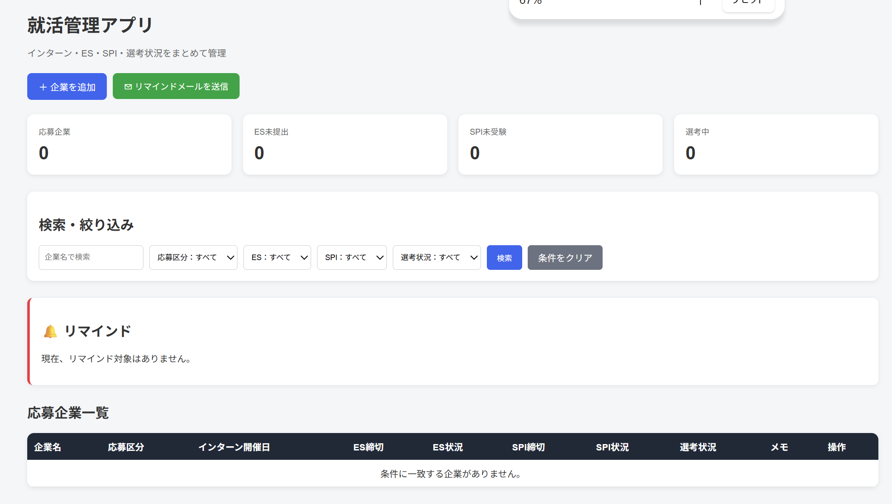

# 就職活動管理アプリ（Job Hunt Manager）

## 1. アプリ概要
複数企業のエントリーシート（ES）や適性検査（SPI）、インターンシップの予定を一元管理するWebアプリケーションです。

就職活動では企業ごとに異なる締切を管理する必要があるため、提出忘れを防ぎ、効率的に就職活動を進めることを目的として開発しました。

## 2. 使用技術
- 言語：Python、HTML
- Webフレームワーク：Flask
- データベース：SQLite
- 通知：Gmail（メール送信）
- 実行環境：Windows
- 定期実行：Windows タスクスケジューラ

## 3. 主な機能
### 企業・選考情報の管理
- 応募企業と締切情報の登録・表示・編集・削除
- ES・SPIの提出状況の管理

### 自動リマインド機能
- ES・SPIの締切が3日以内に迫った場合にメールで通知
- 翌日に予定されたインターンシップをメールで通知
- Windows タスクスケジューラを利用して毎朝9時に自動実行

## 4. 開発で工夫した点
### 課題に合わせた機能設計
単なる一覧管理にとどまらず、締切を見落とさない仕組みとして自動通知機能を実装しました。

### 日常的に利用できる仕組み
Windows タスクスケジューラを利用し、毎回手動でプログラムを起動しなくても通知できるよう工夫しました。

### エラーへの対応
メール送信機能の実装時に発生した認証エラーについて、原因を調査し、設定を修正することで正常に送信できるようにしました。

## 5. 開発を通じて学んだこと
PythonによるWebアプリケーション開発、SQLiteを用いたデータ管理、外部サービスを利用した通知処理を学びました。

また、利用者の課題を考え、必要な機能を設計・実装し、不具合を検証しながら改善することの重要性を実感しました。

## 6. 今後の改善予定
- スマートフォンに対応した画面設計
- PWA対応
- 締切時刻を含む予定管理

## 7. 画面イメージ

### ダッシュボード

応募企業数、ES・SPIの提出状況、選考状況を一覧で確認できます。

また、検索・絞り込み機能によって、必要な企業情報を素早く確認できます。
