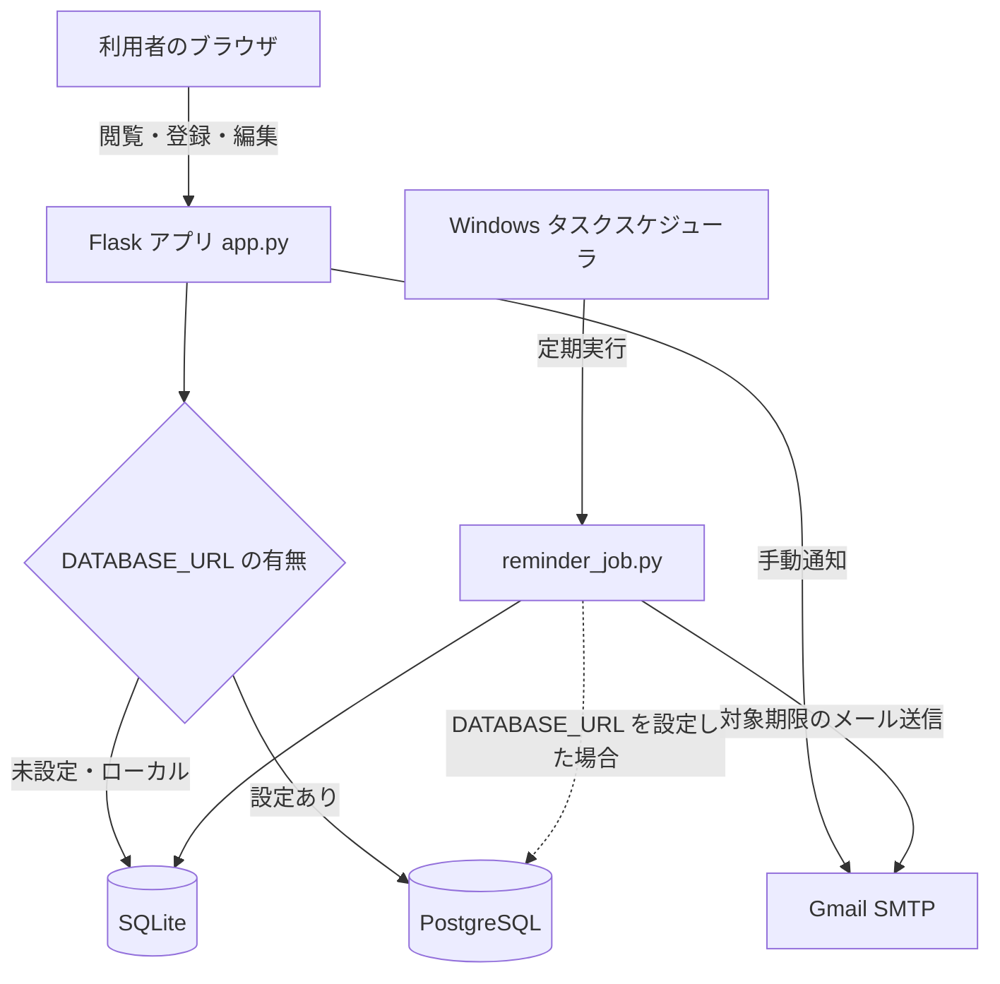

# 就職活動管理アプリ | Job Hunt Manager

**複数企業の選考予定を一元管理し、ES・SPIの締切忘れを防ぐために個人開発したWebアプリケーションです。**

Python / Flaskを用いて、応募企業の情報管理から締切までの残り時間の表示、Gmailによるリマインド通知まで実装しました。


> **公開範囲について**：ソースコードをGitHubで公開していますが、現在のアプリ運用は個人のWindows PC上のみです。リポジトリ内のクラウド向け設定は、公開サービスの稼働を意味するものではありません。

## 1. 開発の背景・目的

就職活動では企業ごとにエントリーシート（ES）や適性検査（SPI）、インターンシップの日程が異なり、複数の予定を把握し続ける必要があります。

そこで、**予定を一覧化するだけでなく、締切が近づいたときに自動で気づける仕組み**が必要だと考え、本アプリを開発しました。

## 2. 主な機能

| 機能 | 内容 |
| --- | --- |
| 企業情報管理 | 応募企業・応募区分・インターン日程・メモなどの登録、表示、編集、削除 |
| 選考状況管理 | ES提出・SPI受験・選考ステータスの変更 |
| 検索・絞り込み | 企業名、応募区分、ES・SPI・選考ステータスによる絞り込み |
| 締切管理 | 日時を保存し、残り日数・時間や期限切れを表示 |
| リマインド一覧 | ES・SPIの期限が72時間以内の未完了項目などを表示 |
| メール通知 | GmailのSMTPを用いて対象の予定をメール送信 |
| 定期実行 | Windowsタスクスケジューラから通知用スクリプトを実行する構成 |

※画面のリマインド一覧と定期メール通知では、インターンの通知条件が一部異なります。画面側は当日と翌日、定期メール側は翌日を対象としています。

## 3. 使用技術

| 分野 | 技術 |
| --- | --- |
| プログラミング言語 | Python、HTML |
| Webアプリケーション | Flask、Jinjaテンプレート |
| データベース | SQLite（ローカル環境）、PostgreSQL（接続先の切り替えに対応） |
| データベース接続 | Python標準の `sqlite3`、`psycopg` |
| メール送信 | Gmail SMTP（`smtplib`） |
| 設定管理 | `python-dotenv`、環境変数 |
| 定期実行 | Windowsタスクスケジューラ |
| 起動方法 | Pythonによるローカル起動。Gunicorn用の設定ファイルも用意 |

## 4. システム構成



ローカルではSQLiteを使用し、環境変数 `DATABASE_URL` が設定されている場合にはPostgreSQLへの接続を選ぶ構成です。現在の運用はローカルPCで行っています。

## 5. 工夫した点・課題解決

### 5.1 利用目的から逆算した機能設計

単に企業情報を保存するだけでなく、**提出し忘れるリスクを減らすこと**を重視しました。ES・SPIの完了状態を判定し、期限が72時間以内に迫った未完了項目を抽出できるようにしました。

### 5.2 締切までの残り時間の可視化

日付だけでなく日時を取り扱い、期限までの残り時間を「あと○日○時間」「あと○分」といった形式で表示します。過去の日付のみの形式も読み取れるようにしました。

### 5.3 繰り返し使う処理の分離

データベース接続処理を関数化し、ローカルのSQLiteとPostgreSQLで接続先を切り替えられるようにしました。また、SQLに入力値を埋め込む部分ではプレースホルダーを使用しています。

### 5.4 メール通知の認証エラーへの対応

Gmail通知機能を実装する際、メール送信時の認証エラーが発生しました。エラー内容と設定を確認し、認証設定を見直すことで送信できるようにしました。メールアドレスやアプリパスワードはコードに直接書かず、環境変数から読み込む設計にしています。

### 5.5 手動操作に依存しない通知

メール通知を毎回手動で起動する必要がないよう、通知処理を `reminder_job.py` に分けました。Windowsタスクスケジューラから実行することで、定期的なチェックに対応しています。

## 6. ローカル環境での起動方法（Windows）

### 6.1 リポジトリを取得

```powershell
git clone https://github.com/kira5151/job_hunt_manager.git
cd job_hunt_manager
```

### 6.2 ライブラリをインストール

```powershell
py -m pip install -r requirements.txt
```

### 6.3 アプリを起動

```powershell
py app.py
```

起動時に表示されるURL（通常は `http://127.0.0.1:5000`）をブラウザで開きます。SQLiteのデータベースは初回起動時に初期化されます。

### 6.4 メール通知を利用する場合

Gmail通知機能を利用するには、リポジトリ直下の `.env` に必要な環境変数を設定します。

```dotenv
GMAIL_ADDRESS=your-address@example.com
GMAIL_APP_PASSWORD=your-app-password
REMINDER_EMAIL=destination@example.com
SECRET_KEY=replace-with-a-long-random-secret
```

`.env` は `.gitignore` の対象です。**実際のアプリパスワードや個人情報はコミットしないでください。** GitHubに一度公開した秘密情報は、後からファイルを削除するだけでは履歴から消えません。

リマインド処理を手動で確認する場合：

```powershell
py reminder_job.py
```

定期実行には別途Windowsタスクスケジューラの設定が必要です。

## 7. 開発を通じて学んだこと

個人の困りごとを出発点として、**課題を整理し、必要な機能を設計・実装し、動作確認と改善を繰り返す**流れを経験しました。Web画面、データベース、メール通知、定期実行を組み合わせることで、複数の技術を連携させる実践的な開発経験を得ました。

## 8. 今後の改善予定

- スマートフォンで操作しやすい画面への改善
- PWAへの対応
- 入力値の検証やエラー処理の充実
- 通知処理の共通化と自動テストの追加
- 複数ユーザーによる利用を想定する場合の認証・アクセス制御

---

**開発形態：個人開発**  
**現在の動作環境：Windows PC（ローカル）**
